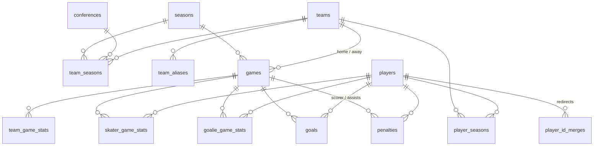

# Database schema and IDs

The schema lives in [db/schema.sql](../db/schema.sql) (PostgreSQL). Teams and players get
stable ids from [src/transform/id_mapping.py](../src/transform/id_mapping.py), which writes
the id tables to `data/processed/ids/`. Run it with `make ids`.

## Tables

| Table | Grain | Source |
|---|---|---|
| `seasons` | one per season (`2025-26`) | |
| `conferences` | one per conference | `all_games` |
| `teams` | one per team; D1 teams carry `chn_team_id` | `ids/teams.csv` |
| `team_aliases` | every name a team appears under ("Rensselaer", "RPI") | `ids/team_aliases.csv` |
| `team_seasons` | team × season, with that season's conference | `ids/team_seasons.csv` |
| `players` | one per real player | `ids/players.csv` |
| `player_seasons` | player × season × team (the roster), with that season's spelling | `ids/player_seasons.csv` |
| `player_id_merges` | retired ids → the id that replaced them | `ids/player_id_merges.csv` |
| `games` | one per scheduled game | `all_games` + `box_games` |
| `team_game_stats` | team × game | `box_team_stats` |
| `skater_game_stats` | skater × game | `box_skaters` |
| `goalie_game_stats` | goalie × game | `box_goalies` |
| `goals` | one per goal | `box_goals` |
| `penalties` | one per penalty (bench penalties have no player) | `box_penalties` |

The views `skater_season_totals`, `goalie_season_totals` and `team_season_totals` add up the
fact tables by season (points, save %, GAA, PP %, PK %, faceoff %).

## How IDs are assigned

**Teams.** The schedule page links each D1 team to its CHN team id, so each CHN id is one
team, whatever it's called that season. The non-D1 opponents (2 so far) have no CHN id and are keyed
by name. "TBD" (an opponent not yet decided) is not a team.

**Players.** Only goal scorers link to a CHN player page. Everyone else appears by name only:
skaters who never scored, goalies, assists and penalties. A *player-season* is
`(season, team, name)`. The name is matched without accents, case, punctuation or
"Jr."/"III", so "Jérémie Minville" matches "Jeremie Minville". Player-seasons are then linked
into players, and each `player_seasons.link` records which rule did it:

| `link` | Rule | Player-seasons |
|---|---|---:|
| `chn_id` | the player scored, so CHN's player id identifies them (this also catches transfers and spelling changes like "Joseph" → "JJ Grainda") | 1,787 |
| `team_and_name` | same team, same name, another season | 578 |
| `name_transfer` | history ends on team A in season N, the same name starts on team B in N+1, one-to-one | 112 |
| `single_season` | no other season to link to | 625 |
| `ambiguous` | same team and name but two different CHN ids (two real people); left unlinked | 0 |

Result (2025-26 and 2026-27): 65 teams (63 D1) and 2,134 players. 1,384 players have a CHN id
and 186 have played for more than one team.

**How reliable is `name_transfer`?** In the players whose CHN ids prove who is who, the same
pattern (same name, back-to-back seasons, different teams) was a real transfer about 99% of the
time. It's there mainly for transfers who haven't scored for their new team yet. In 2026-27
that's most incoming transfers. Treat these links as very likely, not certain.

**Known limits.**
- Two different players with the same name on the same team in the same season would be
  merged into one. No game in the data shows two players with one name on a team.
- CHN's "Uknown" scorer rows (CHN's spelling) are ignored. The CHN ids on those rows point at
  players who aren't in that game's box score.
- A player who changes teams and also changes how their name is written can't be linked until
  they score.

## Keeping IDs stable

The CSVs in `data/processed/ids/` act as a registry. Like all data in this project they are
gitignored, so keep the folder when moving machines. Each run reads them
back and keeps every existing id. New teams and players get the next number, so adding a
season or rescraping never renumbers anyone, which an API's users depend on. If new data shows
two ids are the same player (an id-less player later scores, and CHN's link matches them to
another id), the lower id is kept. The old one goes in `player_id_merges.csv`, so a request for
it can be redirected.

## Data source and use

All data comes from [College Hockey News](https://www.collegehockeynews.com). Before sharing
it, read CHN's [Terms and Conditions](https://www.collegehockeynews.com/community/terms.php)
(checked 2026-11-08):

- The site grants a "personal, non-exclusive, non-commercial" licence to view the content.
  Copying, redistributing and republishing are prohibited without written permission. The
  protected content explicitly includes "compilations", meaning the site's collected stats
  and schedules.
- Other sites may link to CHN content but not replicate it.
- [robots.txt](https://www.collegehockeynews.com/robots.txt) asks crawlers not to fetch
  `/box/final/` pages from 2024 and earlier. Only the current and previous calendar years are
  open.

What this means for the project: building the database and API for personal, non-commercial
analysis is the use the terms allow. Publishing the dataset or a public API built from it
needs written permission from CHN (contact: public@collegehockeynews.com). The schema and
code can be shared freely; the data can't, which is why `data/` is gitignored.
